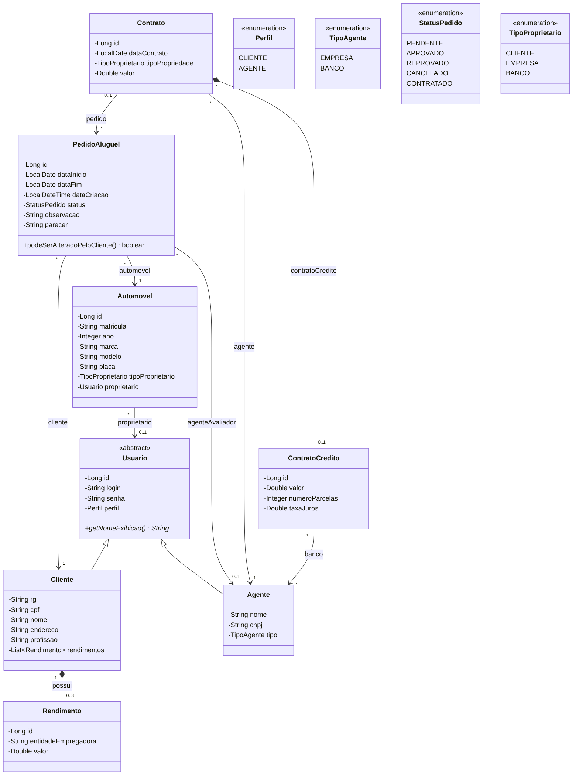
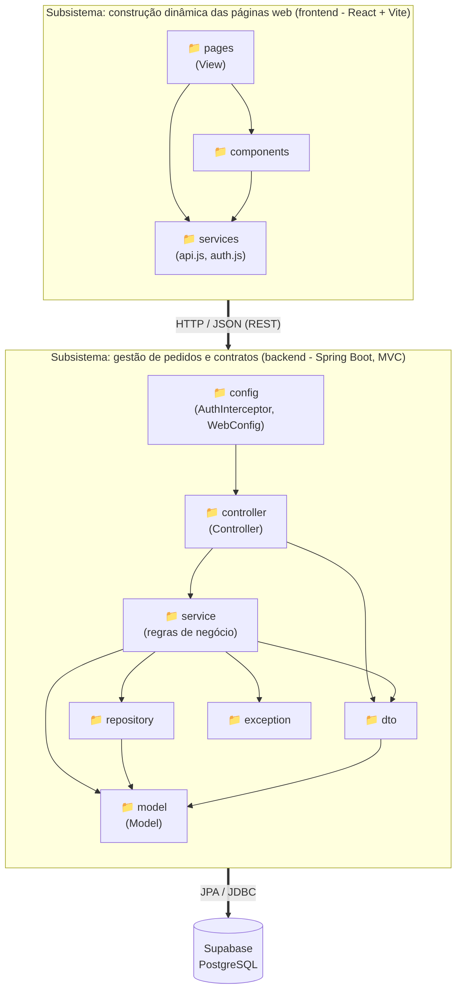
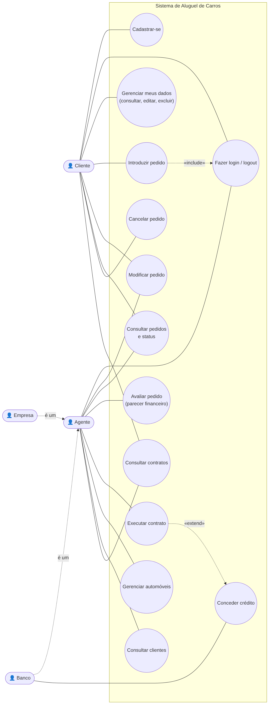
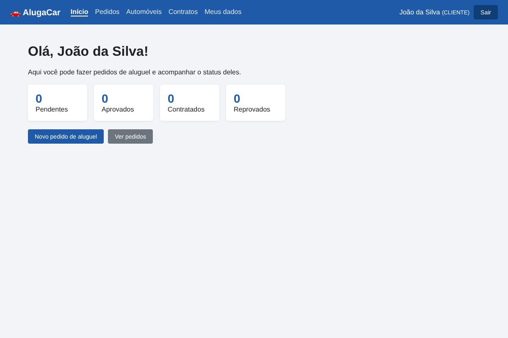
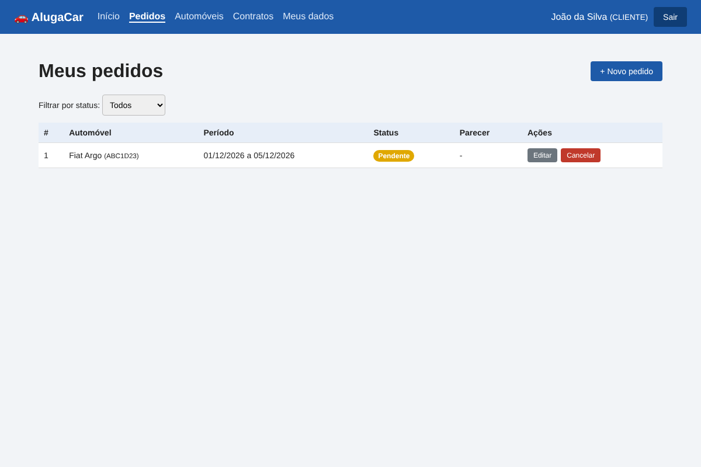
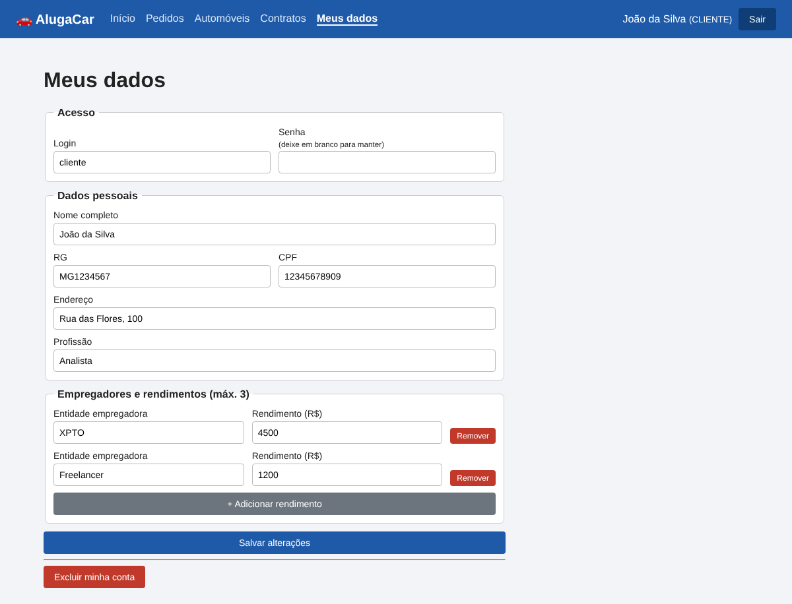
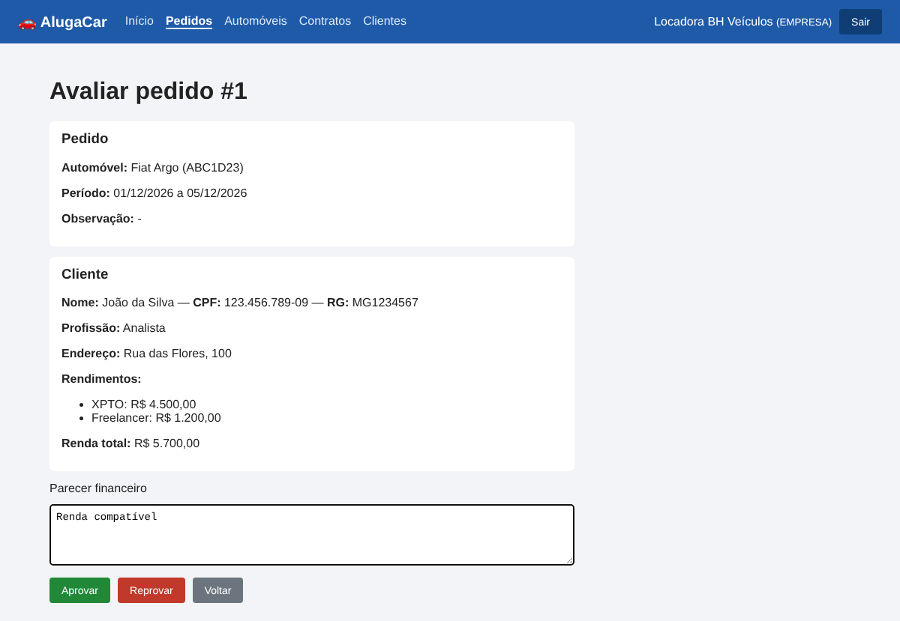
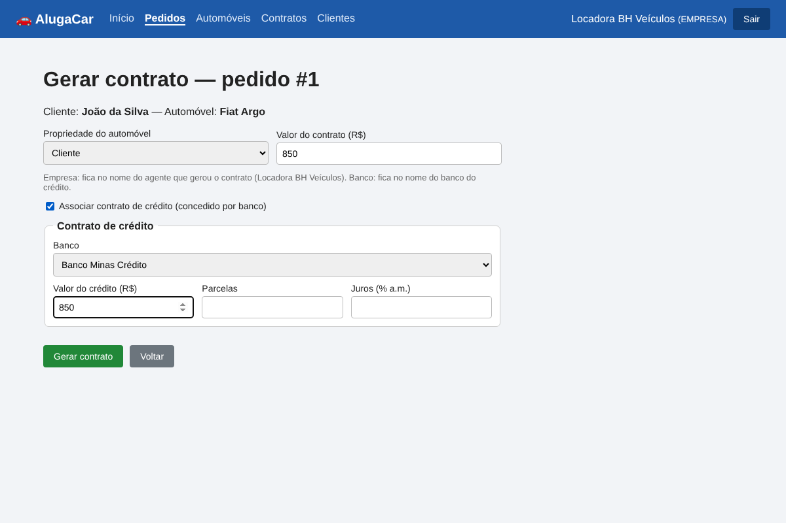
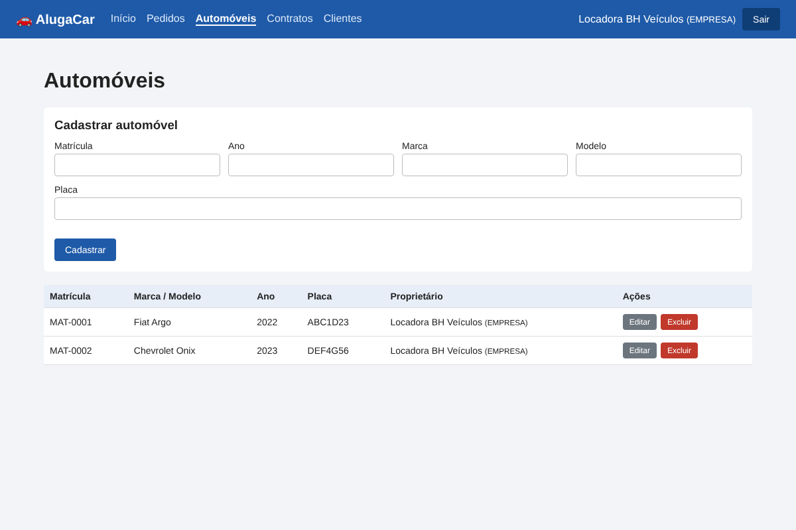

# 🚗 AlugaCar — Sistema de Aluguel de Carros 👨‍💻

> [!NOTE]
> Sistema web para gestão de aluguéis de automóveis: clientes fazem, modificam, consultam e cancelam pedidos
> pela internet, e agentes (empresas e bancos) avaliam os pedidos financeiramente e geram os contratos.

<table>
  <tr>
    <td width="800px">
      <div align="justify">
        Projeto desenvolvido para o <b>Laboratório 02</b> da disciplina <i>Desenvolvimento e Integração de Aplicações Web (DIAW)</i>
        do curso de <b>Engenharia de Software</b> da PUC Minas. O sistema só pode ser usado após <b>cadastro prévio</b> e
        <b>login</b>. Foi construído com <b>Spring Boot</b> (arquitetura <b>MVC</b>) no back-end, <b>React + Vite</b> no
        front-end e <b>Supabase (PostgreSQL)</b> como banco de dados. Os modelos UML (casos de uso, histórias de usuário,
        classes e pacotes) estão versionados em <a href="docs/">docs/</a>, com a versão inicial (v1) e a revisada (v2).
      </div>
    </td>
    <td>
      <div>
        
      </div>
    </td>
  </tr>
</table>

---

## 🚧 Status do Projeto


Protótipo **funcional**, em fase final de validação para a entrega do LAB02.

---

## 📚 Índice
- [Links Úteis](#-links-úteis)
- [Sobre o Projeto](#-sobre-o-projeto)
- [Funcionalidades Principais](#-funcionalidades-principais)
- [Tecnologias Utilizadas](#-tecnologias-utilizadas)
- [Arquitetura](#-arquitetura)
- [Modelagem (UML)](#-modelagem-uml)
- [Instalação e Execução](#-instalação-e-execução)
- [Deploy](#-deploy)
- [Estrutura de Pastas](#-estrutura-de-pastas)
- [Demonstração](#-demonstração)
- [Testes](#-testes)
- [Documentações utilizadas](#-documentações-utilizadas)
- [Autores](#-autores)
- [Contribuição](#-contribuição)
- [Agradecimentos](#-agradecimentos)
- [Licença](#-licença)

---

## 🔗 Links Úteis
* 🐙 **Repositório GitHub:** [matheusnNicoli/LABORAT-RIO-2diaw](https://github.com/matheusnNicoli/LABORAT-RIO-2diaw)
* 📖 **Documentação / Modelagem:** [docs/](docs/README.md)
* 🔄 **Evolução dos modelos (v1 → v2):** [docs/CHANGELOG_MODELOS.md](docs/CHANGELOG_MODELOS.md)
* 🌐 **Demo Online:** não publicada (o projeto roda localmente).

---

## 📝 Sobre o Projeto

O objetivo é apoiar a gestão de aluguéis de automóveis, permitindo **efetuar, cancelar e modificar pedidos
pela internet**. O fluxo principal é:

1. O **cliente** se cadastra (RG, CPF, nome, endereço, profissão e até 3 empregadores com rendimentos) e faz login.
2. O cliente cria um **pedido de aluguel** escolhendo o automóvel e o período. O pedido fica **PENDENTE**.
3. Um **agente** (empresa ou banco) faz a **análise financeira** e dá um parecer: **APROVADO** ou **REPROVADO**.
4. Com parecer positivo, o agente **executa o contrato**. Dependendo do contrato, o automóvel fica registrado
   como propriedade do **cliente**, da **empresa** ou do **banco**, e o aluguel pode ter um **contrato de crédito**
   concedido por um banco.
5. O cliente acompanha o **status** dos pedidos e os contratos.

O sistema é dividido em dois subsistemas, como pede o enunciado: **gestão de pedidos e contratos** (back-end) e
**construção dinâmica das páginas web** (front-end).

---

## ✨ Funcionalidades Principais

- 🔐 **Autenticação:** login e logout com usuário e senha (senha criptografada com BCrypt). Todas as rotas da API, exceto login e cadastro, exigem token.
- 👤 **CRUD de Cliente:** cadastro, consulta, edição e exclusão, com até 3 rendimentos.
- 📝 **Pedidos de aluguel:** cliente cria, modifica, consulta e cancela; agente modifica e avalia.
- 📊 **Status do pedido:** PENDENTE → APROVADO/REPROVADO → CONTRATADO (ou CANCELADO), com filtro na listagem.
- 📄 **Contratos:** geração a partir de pedidos aprovados, definindo o proprietário do automóvel.
- 🏦 **Contrato de crédito:** opcional, concedido exclusivamente pelo banco autenticado (valor, parcelas e juros).
- 🚘 **Automóveis:** cadastro de matrícula, ano, marca, modelo e placa (feito pelos agentes).
- 🛡️ **Permissões por perfil:** cliente e agente veem telas e ações diferentes.

---

## 🛠 Tecnologias Utilizadas

### 💻 Front-end
* **Biblioteca:** React 19
* **Linguagem:** JavaScript (ES6+)
* **Rotas:** React Router DOM 7
* **Estilização:** CSS puro
* **Build Tool:** Vite 8

### 🖥️ Back-end
* **Linguagem:** Java 25 (JDK 25)
* **Framework:** Spring Boot 4.0.0 (Spring MVC)
* **Build e dependências:** Apache Maven
* **Banco de Dados:** Supabase (PostgreSQL)
* **ORM:** Spring Data JPA / Hibernate
* **Autenticação:** token de sessão próprio (`AuthInterceptor`) + BCrypt (`spring-security-crypto`)
* **Validação:** Bean Validation (`spring-boot-starter-validation`)

---

## 🏗 Arquitetura

O back-end segue a arquitetura **MVC** com camada de serviço:

| Camada | Pacote | Responsabilidade |
|---|---|---|
| **Model** | `model` | Entidades JPA (Usuario, Cliente, Agente, Rendimento, Automovel, PedidoAluguel, Contrato, ContratoCredito) |
| **Controller** | `controller` | Endpoints REST, recebem e devolvem JSON |
| **View** | `frontend/src/pages` | Telas em React que consomem a API |
| Service | `service` | Regras de negócio (status do pedido, limite de rendimentos, permissões) |
| Repository | `repository` | Acesso ao banco com Spring Data JPA |
| DTO | `dto` | Objetos de entrada e saída da API (não expõem a senha) |
| Config | `config` | Interceptor de autenticação, CORS, BCrypt e dados iniciais |
| Exception | `exception` | Exceções de negócio e tratador global de erros |

**Fluxo de uma requisição:** `React (pages → services/api.js)` → HTTP/JSON → `AuthInterceptor` (confere o token) →
`Controller` → `Service` → `Repository` → `Supabase`.

**Autenticação:** ao fazer login, o back-end gera um token (UUID) e guarda em memória (`TokenService`). O front
salva o token no `localStorage` e envia no header `Authorization: Bearer <token>`. O `AuthInterceptor` bloqueia
com 401 quem não tem token válido, e os services respondem 403 quando o perfil não tem permissão.

**Limitações conhecidas:** como os tokens ficam em memória, ao reiniciar o servidor é preciso logar de novo. Os
agentes de demonstração são cadastrados pelo `DataLoader`; não existe cadastro público de agentes.

### Endpoints principais

| Método | Rota | Quem |
|---|---|---|
| POST | `/api/auth/login` · `/api/auth/logout` · GET `/api/auth/me` | todos |
| POST | `/api/clientes` (cadastro) | público |
| GET / PUT / DELETE | `/api/clientes/{id}` | o próprio cliente (agente pode consultar/excluir) |
| GET | `/api/clientes` | agente |
| GET / POST / PUT / DELETE | `/api/automoveis` | GET todos; o resto agente |
| GET / POST | `/api/pedidos` | cliente (os seus) / agente (todos) |
| PUT | `/api/pedidos/{id}` | cliente (pendente) / agente |
| PATCH | `/api/pedidos/{id}/cancelar` | cliente |
| PATCH | `/api/pedidos/{id}/avaliar` | agente |
| POST | `/api/pedidos/{id}/contrato` | agente |
| GET | `/api/contratos` · `/api/agentes/bancos` | logados |

---

## 📐 Modelagem (UML)

Todas as versões estão em [`docs/`](docs/README.md). Abaixo, a **versão final (v2)**, alinhada ao código:

| Diagrama de Classes | Diagrama de Pacotes (Visão Lógica) |
| :---: | :---: |
|  |  |
| **Casos de Uso** | **Histórias de Usuário** |
|  | [v1](docs/historias-de-usuario/v1.md) · [v2](docs/historias-de-usuario/v2.md) |

---

## 🔧 Instalação e Execução

### Pré-requisitos
* **Java JDK 25**
* **Apache Maven 3.9+**
* **Node.js** 20.19+ ou 22.12+ (exigido pelo Vite 8) e npm
* Um projeto criado no **Supabase**

### 🔑 Variáveis de Ambiente

#### 1 Back-end (Spring Boot)

Copie `backend/.env.example` para `backend/.env` e preencha (o `application.properties` lê esse arquivo):

| Variável | Descrição | Exemplo |
| :--- | :--- | :--- |
| `DB_URL` | URL JDBC do Supabase | `jdbc:postgresql://db.xxxx.supabase.co:5432/postgres` |
| `DB_USERNAME` | Usuário do banco | `postgres` |
| `DB_PASSWORD` | Senha do banco | `sua-senha` |

> [!WARNING]
> O arquivo `.env` está no `.gitignore` e **não deve ser enviado para o GitHub**.

> [!TIP]
> A conexão direta do Supabase (`db.xxxx.supabase.co`) funciona apenas em redes com **IPv6**. Se der erro de conexão
> (`UnknownHostException` ou timeout), use a string do **Session pooler** (Supabase → *Connect* → *Session pooler*):
> `DB_URL=jdbc:postgresql://aws-0-<regiao>.pooler.supabase.com:5432/postgres` e
> `DB_USERNAME=postgres.<id-do-projeto>`.

#### 2 Front-end (React, Vite)

Não precisa configurar nada: o Vite faz proxy de `/api` para `http://localhost:8080` (ver `vite.config.js`).
Opcionalmente, crie `frontend/.env` com `VITE_API_URL`.

### 📦 Instalação de Dependências

```bash
git clone https://github.com/matheusnNicoli/LABORAT-RIO-2diaw.git
cd aluguel-carros
```

#### Front-end (React)
```bash
cd frontend
npm install
cd ..
```

#### Back-end (Spring Boot)
```bash
cd backend
mvn clean install
cd ..
```

### 💾 Inicialização do Banco de Dados (Supabase)

Não é necessário rodar scripts: o Hibernate (`spring.jpa.hibernate.ddl-auto=update`) cria as tabelas na primeira
execução, e a classe `DataLoader` cadastra dados de teste quando o banco está vazio.
O script equivalente está em [`docs/banco/script.sql`](docs/banco/script.sql) (apenas referência).

**Usuários de teste** (senha `123456` para todos):

| Login | Perfil |
|---|---|
| `cliente` | Cliente (João da Silva) |
| `empresa` | Agente — Empresa (Locadora BH Veículos) |
| `banco` | Agente — Banco (Banco Minas Crédito) |

### ⚡ Como Executar a Aplicação

#### Terminal 1: Back-end (Spring Boot)
```bash
cd backend
mvn spring-boot:run
```
🚀 *API disponível em **http://localhost:8080**.*

#### Terminal 2: Front-end (React, Vite)
```bash
cd frontend
npm run dev
```
🎨 *Front-end disponível em **http://localhost:5173**.*

---

## 🚀 Deploy

O projeto ainda não possui ambiente público de produção. A execução da entrega é local, com o front-end em
`http://localhost:5173`, o back-end em `http://localhost:8080` e o banco de dados hospedado no Supabase.

---

## 📂 Estrutura de Pastas

```
.
├── .gitignore
├── LICENSE
├── README.md
├── /docs                              # 📚 Modelagem UML (v1 e v2), histórias, script SQL, prints
│   ├── CHANGELOG_MODELOS.md           # 🔄 O que mudou nos modelos
│   ├── /diagramas/v1 e /v2            # 📐 Casos de uso, classes, pacotes (.mmd + .png)
│   ├── /historias-de-usuario          # 📝 v1.md e v2.md
│   ├── /banco/script.sql              # 💾 Modelo físico
│   └── /prints                        # 🖼️ Capturas de tela
│
├── /backend                           # 📁 Spring Boot
│   ├── .env.example                   # 🧩 Variáveis do banco
│   ├── pom.xml
│   └── /src
│       ├── /main
│       │   ├── /java/br/pucminas/aluguelcarros
│       │   │   ├── /config            # 🔧 AuthInterceptor, WebConfig (CORS), BCrypt, DataLoader
│       │   │   ├── /controller        # 🎮 Endpoints REST
│       │   │   ├── /dto               # ✉️ Requests e responses
│       │   │   ├── /exception         # 💥 Exceções e TratadorDeErros
│       │   │   ├── /model             # 🧬 Entidades JPA e enums
│       │   │   ├── /repository        # 🗄️ Spring Data JPA
│       │   │   └── /service           # ⚙️ Regras de negócio
│       │   └── /resources/application.properties
│       └── /test/java/br/pucminas/aluguelcarros  # 🧪 Testes JUnit/Mockito
│
└── /frontend                          # 📁 React + Vite
    ├── index.html
    ├── vite.config.js                 # proxy /api -> :8080
    ├── package.json
    └── /src
        ├── /components                # 🧱 Navbar, RotaPrivada, ClienteForm, StatusBadge
        ├── /pages                     # 📄 Telas (Login, Cadastro, Pedidos, Contratos...)
        ├── /services                  # 🔌 api.js, auth.js, formatos.js
        └── /styles                    # 🎨 global.css
```

---

## 🎥 Demonstração

### 🌐 Aplicação Web

| Tela | Captura de Tela |
| :---: | :---: |
| **Início (cliente)** | **Meus pedidos (status)** |
|  |  |
| **Meus dados (CRUD cliente)** | **Avaliação financeira (agente)** |
|  |  |
| **Gerar contrato com crédito** | **Automóveis** |
|  |  |

### 💻 Exemplo de uso da API (cURL)

```bash
curl -X POST http://localhost:8080/api/auth/login \
     -H "Content-Type: application/json" \
     -d '{"login":"cliente","senha":"123456"}'
```

**Saída esperada:**
```json
{
  "token": "3f1c9a2e-8b7d-4c1a-9e55-0a6f2d1b7c44",
  "id": 3,
  "nome": "João da Silva",
  "perfil": "CLIENTE",
  "tipoAgente": null
}
```

```bash
curl http://localhost:8080/api/pedidos -H "Authorization: Bearer <token>"
```

---

## 🧪 Testes

O back-end possui testes automatizados com **JUnit 5 e Mockito** para as regras mais críticas:

- bloqueio de pedido quando o automóvel está reservado no período;
- nova avaliação obrigatória após modificar um pedido aprovado;
- bloqueio da aprovação quando o automóvel ficou indisponível;
- impedimento de uma empresa conceder crédito;
- impedimento de um banco conceder crédito em nome de outro banco.

Execute com:

```bash
cd backend
mvn test
```

Também foram realizados testes manuais seguindo os critérios de aceitação das
[histórias de usuário](docs/historias-de-usuario/v2.md): login certo e errado, acesso sem token (401), cliente tentando
usar uma função de agente (403), cadastro com 4 rendimentos, CPF duplicado e o fluxo completo pedido → avaliação → contrato.

---

## 🔗 Documentações utilizadas

* 📖 [Documentação do **Spring Boot**](https://docs.spring.io/spring-boot/index.html)
* 📖 [**Spring Data JPA**](https://docs.spring.io/spring-data/jpa/reference/)
* 📖 [Documentação do **React**](https://react.dev/reference/react)
* 📖 [Guia do **Vite**](https://vite.dev/config/)
* 📖 [**React Router**](https://reactrouter.com/)
* 📖 [Documentação do **Supabase**](https://supabase.com/docs)
* 📖 [**Mermaid** (diagramas)](https://mermaid.js.org/)
* 📖 [**Conventional Commits**](https://www.conventionalcommits.org/en/v1.0.0/)

---

## 👥 Autores

| 👤 Nome | :octocat: GitHub |
|---------|------------------|
| Matheus Nicoli Andrade Coelho | [@matheusnNicoli](https://github.com/matheusnNicoli) |

---

## 🤝 Contribuição

1. Faça um `fork` do projeto.
2. Crie uma branch (`git checkout -b feature/minha-feature`).
3. Faça commit das mudanças (`git commit -m 'feat: adiciona funcionalidade X'`), usando [Conventional Commits](https://www.conventionalcommits.org/en/v1.0.0/).
4. Faça `push` para a branch (`git push origin feature/minha-feature`).
5. Abra um **Pull Request**.

---

## 🙏 Agradecimentos

* [**Engenharia de Software PUC Minas**](https://www.instagram.com/engsoftwarepucminas/), pelo apoio acadêmico.
* [**Prof. Dr. João Paulo Aramuni**](https://github.com/joaopauloaramuni), pelos ensinamentos e pelo material da disciplina.

---

## 📄 Licença

Este projeto é distribuído sob a **Licença MIT**. Consulte o arquivo [LICENSE](LICENSE).

---
